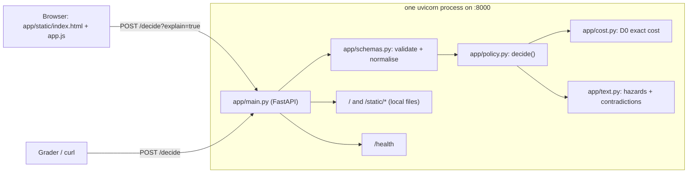

# How this project works — a study guide

This guide is for explaining the project in an interview. Read it alongside the code: each section names the file and the function it describes.

## 1. The one-paragraph version

A JSON case arrives at `POST /decide`. Pydantic validates and normalises it (`app/schemas.py`). The engine (`app/policy.py`) then runs these steps:

1. Compute the repair cost exactly (`app/cost.py`, rule D0).
2. Scan the symptom text for safety hazards and contradictions (`app/text.py`).
3. Check the D5 escalation triggers first, because escalation wins over everything.
4. Check the D3 travel override.
5. Map an unknown warranty to in or out of warranty (D4).
6. Apply D1 (in warranty / extended) or D2 (out of warranty).
7. If a missing input means the answer could go either way, escalate.

Every path produces a decision, a cost, a heuristic confidence and one sentence naming the rule. Nothing is learned and nothing touches the network.

## 2. Architecture



### Request lifecycle

```mermaid
flowchart TD
    A[JSON body] --> B{Pydantic valid?}
    B -- no --> E422[422 with field locations]
    B -- yes --> C[compute_repair_cost]
    C --> D[find_safety_hazards / find_contradictions]
    D --> F{any D5 trigger?\nD5a, D5b, hazard, contradiction}
    F -- yes --> ESC[escalate, cost if computable]
    F -- no --> G{D3: travel > 120 AND cost > 40%?}
    G -- yes --> REP1[replace D3]
    G -- no --> H[D4: which warranty branch(es)?]
    H --> I[D1 and/or D2 on each branch]
    I --> J{all possible outcomes agree?}
    J -- yes --> K[repair / replace + reason + confidence]
    J -- no --> ESC2[escalate: the missing input decides it]
```

## 3. File and function map

| File | Function / class | Responsibility |
|---|---|---|
| `app/main.py` | `decide_case` | HTTP handler. Calls `decide`, returns exactly the five contract fields, plus `trace` when `?explain=true`. A defensive `except` returns `escalate` instead of a 500. |
| | `validation_error` | Custom 422 handler. Returns `loc`/`msg`/`type` and never echoes the input (the default handler crashed on `NaN`). |
| | `health`, `index` | `{"status":"ok"}` and the static page. |
| `app/schemas.py` | `ServiceCase`, `Part` | Request models. Every field except `case_id` is optional. |
| | `_normalise_enum` | `"Out of Warranty"` → `out_of_warranty`; synonym tables (`fridge`, `geyser`, …); anything else raises → 422. |
| | `_coerce_number` | `"6,200"`, `"Rs 900"` → number; `"n/a"` → null; booleans rejected. |
| | `_check_finite_non_negative` | Rejects NaN, ±∞, negatives. |
| | `DecisionResponse`, `ExplainedResponse` | Response models (confidence constrained to 0–1). |
| `app/cost.py` | `exact` | float → exact `Fraction` via its decimal text (0.1 stays 1/10). |
| | `compute_repair_cost` → `CostResult` | D0 formula. Records which parts are missing a price, whether labour hours or rate is missing, and whether travel is missing. |
| `app/text.py` | `normalise` | Lower-case, unify quotes, expand contractions (`won't` → `will not`), fix listed hazard misspellings (`sparkes` → `sparks`), map documented Hinglish phrases (`current lag raha hai` → `getting current`, `dhuan` → `smoke`, `nahi` → `no`). |
| | `find_safety_hazards` | Regex families for sparks, smoke, fire/burning, gas smell, gas leak, electric shock; skips negated mentions. |
| | `_is_negated` | NegEx-style backwards walk over filler tokens to a negation cue. |
| | `find_contradictions` | Fault-family, product-mention and warranty-mention conflicts. |
| | `detect_fault_topics` | Which fault families the text talks about. |
| `app/policy.py` | constants at top | Every threshold, the life table, and the confidence numbers, in one place. |
| | `decide` | The precedence, top to bottom. |
| | `_escalation_triggers` | D5a, D5b, hazard and contradiction → reason fragments. |
| | `_rule_d3`, `_rule_d1`, `_rule_d2` | Individual rules. D1/D2 return a *list* of possible outcomes. |
| | `_warranty_branches` | D4: returns one branch, or two when the age is missing. |
| | `_ratio_exceeds`, `_age_within_life` | Three-valued tests (True / False / None = unknown) that also record near-threshold notes. |
| | `_confidence` | The heuristic in one function. |
| | `_escalation_check_summary`, `_stages`, `_cost_formula`, `_cost_limit`, `_confidence_basis` | Display-only trace for the UI: the outcome of all four D5 checks, and the D5 → D3 → D4 → D1/D2 path with the stage where the case stopped. They never affect the decision. `_confidence_basis` mirrors `_confidence` line by line; a test checks the lines always add up to the real confidence. |
| | `_pct` | Percent formatting: shows one decimal near a threshold so "60.4%" never prints as "60%". |
| `app/static/app.js` | `renderResult`, `caseNote`, `checkHealth` | Renders the recommendation from the API response only. "Copy case note" produces a ticket-ready summary, the status pill polls the real `/health`, and the panel warns when inputs change after a decision. |
| `scripts/generate_cases.py` | `generate` | Seeded synthetic scenarios with labels assigned by construction. |
| `scripts/evaluate.py` | `evaluate`, `macro_f1` | The brief's two metrics plus a list of misses. |

## 4. The rules exactly as implemented

**D0 cost** = Σ part prices + labour_hours × rate + (travel_minutes / 60) × rate.
- Example 1: 6200 + 1.5×900 + 40/60×900 = 6200 + 1350 + 600 = **8150**.
- Example 2: 14500 + 1800 + 375 = **16675**.
- Travel is **not doubled**, even though the text says "allows for the return", because the formula and both examples don't double it.
- Cost is `null` when any part price is null, labour hours is null, or the rate is missing while there is time to price.
- Null travel → travel component 0 (D0 doesn't list travel as making the cost uncomputable).

**Precedence (D6):** D5 triggers → D3 → D4 mapping → D1 or D2 → D5c (missing input decides).

| Rule | Condition (literal inclusivity) | Result |
|---|---|---|
| D5a | prior_repairs_12m ≥ 2 **and** sentiment = negative | escalate |
| D5b | a part price or labour_hours is null | escalate, cost null |
| D5 hazard | text reports sparks / smoke / fire / gas smell / shock (not negated) | escalate, cost kept |
| D5 contradiction | text conflicts with fault, product or warranty | escalate, cost kept |
| D3 | travel **>** 120 **and** cost/replacement **>** 40% | replace |
| D4 | unknown & age **>** 24 → out of warranty; otherwise in warranty; age missing → try both | lower confidence |
| D1b | in/extended, any part lead time **>** 21 | replace |
| D1a | in/extended, cost/replacement **>** 60% → replace, else repair | |
| D2 | out of warranty: repair iff cost ≤ 50% **and** age ≤ 70% × life × 12 | else replace |
| D5c | replacement price null **and** the outcome depends on it | escalate |

Expected life (Appendix E), with the 70% age limit:

| Product | Life | 70% limit |
|---|---|---|
| washing machine | 10 y | 84 months |
| refrigerator | 12 y | 100.8 months |
| dishwasher | 9 y | 75.6 months |
| oven/cooktop | 13 y | 109.2 months |
| air conditioner | 10 y | 84 months |
| water heater | 8 y | 67.2 months |
| microwave | 8 y | 67.2 months |

### The missing-data principle (the most important design idea)

There are two kinds of rule:

- **Override rules and triggers** (D3, D1b, D5a) say "if X, do Y". Without evidence of X they don't fire: a null lead time is not "over 21 days". Confidence drops, and the trace lists the missing input.
- **Base rules** (D1a, D2, D4) must choose repair or replace. If an input is missing, the engine considers *every* value it could take. If all lead to the same decision, it decides; otherwise it escalates.

This is the brief's own wording for D5c ("replacement price null *and the decision depends on it*"), applied consistently. In code it works like this:

- `_ratio_exceeds` / `_age_within_life` return `None` for unknown.
- `_rule_d1` / `_rule_d2` turn `None` into *two* outcomes (repair and replace) tagged with the missing field.
- `decide` escalates when the set of possible decisions has more than one member.

Examples:
- Out of warranty, no replacement price, age 120 months (over 70% of life) → **replace**. The age test fails whatever the price is.
- Out of warranty, no replacement price, young unit → **escalate**. The price decides.
- Unknown warranty, no age, cost 70% → **replace**. D1a (>60%) and D2 (>50%) agree.
- Unknown warranty, no age, cost 20% → **escalate**. D1 says repair; D2 can't check age.

Why D5b is different: its wording has no "depends on it" clause, and example 3 escalates even though other information exists. So a null part price or null labour escalates unconditionally.

## 5. Confidence

This is a heuristic, not a probability. The brief gives no formula, only example values.

| Situation | Value |
|---|---|
| Base: repair | 0.90 |
| Base: replace | 0.85 |
| Base: escalate | 0.70 |
| Escalation from the contradiction heuristic alone | 0.60 (a text guess is weaker evidence) |
| Escalation because a missing input makes the answer ambiguous | 0.65 |
| Deduction: unknown warranty (D4 says "lower the confidence") | −0.10 |
| Deduction: near a threshold (D6) | −0.10 |
| Deduction: each missing input that didn't change the answer | −0.05, capped at −0.10 |

Decisions are clamped to [0.40, 0.95]. All numbers are constants at the top of `policy.py`.

**Near a threshold** means |cost ratio − 40/50/60%| ≤ 0.02, or |age fraction − 70%| ≤ 0.02. These are absolute percentage points (58.5% is near 60%), and only for thresholds the decision actually evaluated. A 41% ratio is not "near 40%" if travel was under 120 minutes, because D3 never ran.

## 6. Text heuristics

**Hazards** (`find_safety_hazards`):
- Regex families with inflections: `spark|sparks|sparking|sparked`, `arcing`, `smoke|smoking`, `caught (on) fire`, `flames`, `burning smell`, `smell of/like gas`, `electric shock`, `shocked me`, `gave my son a shock`, `getting current from the body` (Indian English), `tingling`.
- **Negation:** walk backwards from the match. Filler words ("any", "visible", "signs", "of", "or", other hazard words) are skipped. A negation cue ("no", "not", "never", "without"…) means the mention is negated; any other word ends the search. A comma is crossed only in a coordinated list ("no sparks, smoke **or** flames").
  - "no sparks or smoke" → none.
  - "not cooling, sparks at plug" → sparks (the "not" belongs to "cooling").
  - "no smoke but sparks" → sparks.
  - "smoke: none" → none (post-negation).
- **Spelling and Hinglish:** before matching, `normalise` rewrites whole words from an explicit misspelling list (`sparkes`, `smok`, `shok`, `burnig`…), so "sparkling" and "smoker" are left alone. It also rewrites a few documented Hinglish phrases: "current lag/maar raha hai" → "getting current", "dhuan/dhuaan" → "smoke", "chingari" → "sparks", "aag lag gayi" → "caught fire", "gas ki smell" → "smell of gas". "nahi" becomes "no", so "dhuan nahi hai" is post-negated and "current nahi lag raha" never matches the shock phrase. I chose explicit lists over fuzzy matching so every rewrite can be explained and tested.
- **Exclusions:** "shock absorber" is not a shock. "Fireplace" doesn't match `\bfire\b`. "Gas leak" on an AC or fridge means refrigerant, not a hazard, but a gas *smell* always counts.

**Contradictions** (`find_contradictions`) come in three kinds:
1. **Fault family.** Each of the 12 fault categories has a vocabulary. A contradiction needs (a) the text to mention at least one family, and (b) *none* of the mentioned families to be the declared one or physically compatible with it. Compatible pairs include water_leak↔drainage, noise↔motor and no_power↔electrical↔control_panel. "other" and "installation_or_setup" are compatible with everything. Brief example: `not_cooling` + "door will not close" → door family only → contradiction. But "door won't close so the fridge is warm" mentions cooling too → no contradiction.
2. **Product.** The text names an appliance and never the declared one ("dishwasher won't drain" on a washing_machine case).
3. **Warranty.** The text says the warranty expired while the field says in_warranty/extended, or vice versa.

Unfamiliar wording → no topics → **never** a contradiction. This is what stops "escalate everything".

## 7. Tests (292, all offline)

| File | What it proves |
|---|---|
| `test_examples.py` | C-2001/2/3 decision, cost and confidence match the brief; reasons name D2 / D1b / D5. |
| `test_cost.py` | Formula, no travel doubling, multiple and duplicate parts, empty parts, zero vs null, null propagation, exact fractions, large values. |
| `test_rules.py` | Every boundary (60/50/40/70%, 21/22 days, 120/121 min, 24/25 months, 70% of life for all 7 products); D3 beats D1; D4 branches; near-threshold absolute vs relative; D5c with and without a deciding rule; confidence in [0,1]; determinism. |
| `test_escalation.py` | D5a truth table (1 vs 2 repairs × sentiments); D5b; hazards keep the cost; escalation beats D3, D1b and D2; multiple triggers in one sentence; normal cases are *not* escalated. |
| `test_text.py` | Positive, negative and negated hazard phrases; negation not leaking across clauses; refrigerant rule; one matching and one conflicting text for each of the 12 fault categories; product and warranty contradictions; unfamiliar text. |
| `test_api.py` | `/health`, `/`, no remote assets; exact response keys; case-ID echo (including int and unicode); 422 for bad enums, negatives, NaN/∞, wrong types, malformed JSON; tolerance for casing, synonyms, numeric strings and `labor_*`; every field missing or null still gives 200; `purchase_price` has no effect; determinism; latency < 0.25 s even with 200 parts and long text. |
| `test_challenge.py` | The 14-case post-build challenge over HTTP. Three cases originally failed ("sparkes", "current lag raha hai", `OOW`) and are now regressions, with labels unchanged. |
| `test_corpora.py` | Synthetic corpus (3 seeds) and 35 hand-labelled cases: zero misses; generator determinism and balance; macro-F1 code checked against a hand calculation. |

`conftest.py` patches `socket.connect` and `getaddrinfo` to raise, so any network use fails the run.

Browser tests in `e2e/` (Playwright) drive the real page in Chromium, Firefox and WebKit on Linux, macOS and Windows in CI. They check keyboard use, focus, layout, an axe-core audit and screen-reader names. I ran the screen-reader checklist manually with VoiceOver and Chrome on 13 October 2026, and all 6 checks passed (TESTING.md §3b). NVDA, JAWS and Safari were not tested.

For the tester-style view (test plan, requirements traceability, the 84-case catalogue, defect log, latest results), see [TESTING.md](TESTING.md). It is regenerated from a real run by `scripts/test_report.py`. CI runs everything on Python 3.9 and 3.12 and does a fresh-clone `./run.sh` start check.

**How do you know the test report is honest?** Its result columns are not typed by hand: the script runs pytest, reads the JUnit XML, and fills in each catalogue row from the test it names. It fails if a test fails or if a catalogue row points at a test that no longer exists.

## 8. Limitations to state openly

- The text detectors are keyword-based: English plus a small documented Hinglish and misspelling list. Novel hazard phrasing will be missed.
- The ambiguous interpretations (null travel, null lead time, null age, the near-threshold band) may differ from Bruviti's reading.
- Confidence is not calibrated.
- The synthetic data is mine, so the 100% scores are consistency checks, not accuracy.
- All listed parts are assumed to be required.

## 9. Likely interview questions

**Why no machine learning?** The brief gives the policy, so the labels are a function of the rules. A model trained on rule-generated labels can only approximate that function, and it will err near thresholds, where it matters. Rules are also explainable and exact. ML would be useful for *reading text*, but I have no real labelled tickets to train or check it on.

**Why is exactly 60% a repair?** D1a says "exceeds 60 percent", and exceeds is strict. Exact fractions guarantee 60.000% really compares as equal.

**Why not double the travel time?** The sentence says the formula "already allows for the return", meaning the formula is final as written. Both worked examples confirm minutes/60 × rate. Doubling would make example 1 cost 8750, not 8150.

**What happens if travel minutes is null?** The cost is still computed (D0 lists only part price and labour hours as making it uncomputable), D3 cannot fire, and confidence drops by 0.05. Escalating would add a trigger D5 doesn't contain.

**Replacement price is null — do you always escalate?** No. Only if the decision depends on it. D1b (a long lead time) or a failed D2 age test settles the case without it. That is D5c's own wording.

**Why does a null part price always escalate, even when D1b would replace?** D5b has no "depends on it" clause, escalation wins over everything (D6), and example 3 shows it. The difference between D5b's and D5c's wording is deliberate.

**How do you avoid escalating everything?** Text triggers are conservative: negation handling, and contradictions only with clear evidence. Missing inputs escalate only when they change the answer. A test asserts that ordinary cases across the ratio range never escalate.

**How does negation work?** It is a simplified NegEx: walk back from the hazard word over filler words to a cue like "no" or "not"; anything else stops the walk, and commas need an "or" list. "No sparks or smoke" → no hazard; "not cooling, sparks at plug" → hazard.

**What does confidence mean?** A transparent score anchored on the brief's example values, lowered for unknown warranty, near-threshold ratios and non-decisive missing inputs. It is not a probability, and I say so in the UI.

**What would you do with real data?** Measure hazard recall and contradiction precision on real tickets, grow the vocabularies, confirm the ambiguous interpretations with the policy owner, and calibrate confidence against reviewed outcomes.

**How do you know the synthetic labels aren't circular?** They are assigned by scenario design from the written rules, and costs are recomputed independently. The engine is never used to label. The corpus caught a real bug ("gave my son a shock").

**Why does `?explain=true` exist instead of adding fields to the response?** The contract lists exactly five fields; the graders' parser may be strict. The trace is opt-in, for the UI and for audits.

**How did you handle misspellings and Hinglish?** With explicit whole-word and phrase lists applied before detection, not fuzzy matching or an LLM, so every rewrite is explainable and tested next to near-miss negatives ("sparkling", "current bill", "current nahi lag raha"). I added them after a 14-case challenge missed "sparkes" and "current lag raha hai". I kept that challenge's labels unchanged.

**Why does the UI look like an agent workspace and not a chatbot?** The user is a service agent closing a ticket. They need the recommended action, the rule behind it, what was checked, and a note to paste into the case record. A chat box would hide the evidence and suggest an LLM that isn't there. Every number on the page comes from the API response: no sample queues, no invented statistics, no third-party branding.

**What was the hardest bug?** The Windows start-up check in CI never became healthy. I diagnosed it on a real Windows runner with a probe workflow and found two causes:
1. GitHub's Windows runners kill every process a step started when that step ends. A control `Start-Sleep` process died too, so the server started in its own step could never be reached from the next one.
2. `run.ps1` used the `py` launcher, which picked Python 3.14, and my pinned pydantic 2.10 had no 3.14 wheel, so pip tried to compile Rust and failed.

The second one would have broken `./run.sh` for anyone on Python 3.14, on any OS. The fixes: one-process start-and-check (`scripts/smoke_start.py`) with a 60 s bound and real diagnostics, pins with cp39–cp314 wheels, and Python 3.14 in CI.

**What happens if the engine itself crashes?** The handler catches it and returns `escalate` with confidence 0.3 and a "manual review" reason. A valid case never gets a 500.
